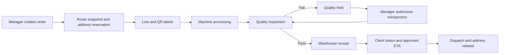
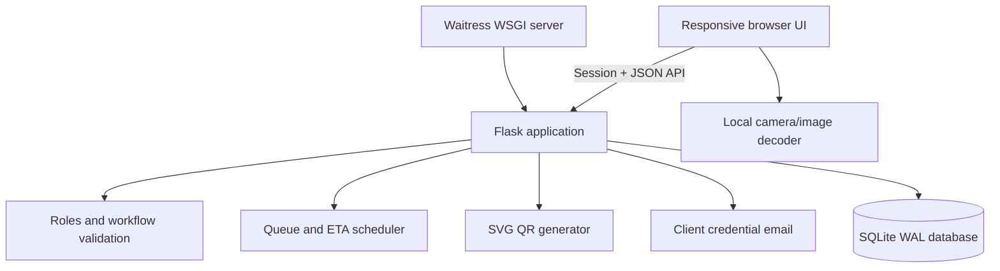

# ForgeFlow

**Advanced Manufacturing Management System**

ForgeFlow is a responsive manufacturing operations application for planning production routes, scheduling shared machines, tracing lots with QR codes, recording shop-floor work, managing quality checks and warehouse addresses, and sharing approved progress with clients.

It gives managers, operators, quality checkers, warehouse staff, and clients one traceable workflow from order creation to dispatch.

> Current release: [v1.0.0](https://github.com/vrushanksuryawanshi/advanced-manufacturing-management-system/releases/tag/v1.0.0)
>
> Stack: Python, Flask, SQLite, Waitress, HTML, CSS, and browser-native JavaScript
>
> Interfaces: responsive desktop, tablet, and mobile workspaces

## Contents

- [What the system solves](#what-the-system-solves)
- [Real-world workflow](#real-world-workflow)
- [Roles and permissions](#roles-and-permissions)
- [Features](#features)
- [Quick start](#quick-start)
- [Using the application](#using-the-application)
- [Scheduling and analytics](#scheduling-and-analytics)
- [Architecture and data](#architecture-and-data)
- [Configuration](#configuration)
- [Security](#security)
- [Testing](#testing)
- [Deployment and backup](#deployment-and-backup)
- [Current boundaries](#current-boundaries)
- [Troubleshooting](#troubleshooting)

## What the system solves

Production information is often split between paper job cards, spreadsheets, verbal updates, and separate quality or warehouse records. ForgeFlow connects that information so the factory can answer:

- What is being produced now, and where is each lot?
- Which operation should run next on each machine?
- What is waiting, blocked, delayed, or on quality hold?
- Who started and completed each process?
- How did actual time compare with the plan and historical work?
- Where is finished stock stored?
- What completion estimate has been approved for the client?

ForgeFlow plans and records the work around physical equipment. It does not control CNC machines, PLCs, or safety systems.

## Real-world workflow

For an order of 500 precision gears, a manager can select this saved route:

```text
Material cutting -> CNC machining -> Surface finishing -> Quality inspection -> Warehouse 1/4
```

If the manager chooses a lot size of 100, ForgeFlow creates five independently traceable lots. It copies the confirmed route into each lot, reserves the warehouse address, creates five QR labels, calculates machine queues, and produces an original plan and live forecast.

The QR stays attached to the lot traveler, pallet, container, or job card. At every station, the responsible employee scans the same label, reads the instruction, starts the process, performs the physical work, and scans again to complete it.



Every accepted action records the user, lot, operation, time, and relevant decision details.

## Roles and permissions

| Role | Responsibilities | Boundaries |
| --- | --- | --- |
| **Manager** | Configure stations, approve staff, create clients, products, routes and orders, print labels, manage queues and availability, authorize reinspection, approve ETAs, and review analytics | Full operational workspace; managers are created only during initial setup |
| **Machine operator** | View one assigned machine queue, scan lots, read instructions, and record starts/completions | Cannot skip steps, bypass queues, use another station, or perform QC/storage work |
| **Quality checker** | Inspect lots at one assigned QC station and record pass/fail with notes | Failed lots remain held until a manager authorizes reinspection |
| **Warehouse manager** | Receive QC-approved lots into reserved addresses and dispatch complete orders | Acts only on the assigned warehouse |
| **Client** | View owned orders, progress, stage, status, due date, and approved ETA | Cannot see internal queues, staff data, other clients, or unapproved forecasts |

Staff register from the sign-in page as a machine operator, quality checker, or warehouse manager. They cannot sign in until a manager approves the request and assigns a matching station.

## Features

### Factory and route configuration

- Any number of production machines, QC stations, and warehouses.
- Visual factory floor and route builder.
- Station codes, names, type, availability, queue, workload, and utilization.
- Validated routes containing production steps followed by QC and storage.
- Planned minutes per lot, transition allowances, and work instructions per step.
- Versioned routes: revisions create a new version instead of rewriting history.
- Existing orders retain the route snapshot used at creation.

### Orders, lots, and QR traceability

- Client, product, route, quantity, lot size, priority, due date, and one or more storage addresses.
- Automatic split into up to 100 lots, including a smaller final lot.
- Unique order codes, lot codes, and cryptographically random QR tokens.
- Printable lot-traveler labels with part, quantity, route version, and sequence.
- Camera scanning, QR-image upload, and manual lot-code entry.
- Local browser decoding; images are not sent to an external QR service.
- A QR identifies a lot but never authenticates a user or completes work automatically.

### Scheduling and production control

- Shared-machine queues across simultaneous orders.
- Route precedence and one running lot per station.
- Forecasts using processing time, transitions, queues, priority, and actual events.
- Immutable original plan alongside the recalculated forecast.
- Manager priority overrides with mandatory reason and audit history.
- Running work is never preempted.
- Unavailable stations and QC holds block affected downstream forecasts.
- Server-side prevention of skipped steps, duplicate starts, double completion, wrong-station work, and unauthorized job types.

### Quality, warehouse, and clients

- QC pass/fail recording; failed checks require notes.
- Quality hold and manager-authorized reinspection with preserved failed attempts.
- Warehouse grids beginning with addresses `1/1` through `3/10`.
- Additional warehouse rows and bays.
- Available, reserved, and occupied address states.
- Transactional protection against duplicate address reservations.
- Receipt into the order's reserved address.
- Dispatch reference and address release after every order lot is stored.
- Client accounts with generated temporary passwords delivered through STARTTLS SMTP.
- Client-specific data filtering and manager-approved ETA publication.

### Visibility and analytics

- Manager overview of active, running, held/delayed, and completed orders.
- Machine pulse, queues, next work, planned workload, and trailing 24-hour utilization.
- Lot timeline and activity log for production and management decisions.
- Planned-versus-actual timestamps, start delay, completion delay, and waiting/transfer time.
- Historical duration benchmark after five comparable completed observations.
- Quantity-weighted order progress and dynamically recalculated internal ETA.

## Quick start

### Requirements

- Python 3.11 or newer.
- A current Edge, Chrome, Firefox, or Safari browser.
- Node.js only for browser tests.
- SMTP access only for creating real client accounts.

### Windows

1. Clone or download the repository.
2. Run `Setup.bat` once.
3. Run `Start Demo.bat`.
4. Open [http://127.0.0.1:5000](http://127.0.0.1:5000).
5. Keep the terminal window open while using the app.

### Manual installation

```bash
git clone https://github.com/vrushanksuryawanshi/advanced-manufacturing-management-system.git
cd advanced-manufacturing-management-system
python -m venv .venv
```

```powershell
# Windows PowerShell
.\.venv\Scripts\Activate.ps1
```

```bash
# macOS or Linux
source .venv/bin/activate
```

Then, on either platform:

```bash
python -m pip install -r requirements.txt
python app.py --demo
```

### Demo accounts

All demo accounts use `FactoryDemo123!`.

| Workspace | Email |
| --- | --- |
| Manager | `manager@demo.local` |
| Machine operator | `operator@demo.local` |
| Client | `client@demo.local` |
| Second client for isolation testing | `other-client@demo.local` |

`--demo` seeds data only when no users exist. Restarts preserve `instance/manufacturing.db`; demo orders begin waiting and no production measurements are fabricated.

### Clean real installation

Use a copy with no `instance` directory, install dependencies, then run:

```bash
python app.py --init-manager
```

Enter the first manager's name, email, and password. Then add stations, configure SMTP, create clients, approve staff, build routes, and create orders. Do not use demo accounts or `--demo` for a live installation.

## Using the application

### Manager

1. Add production, QC, and storage stations under **Machines**.
2. Configure outbound email and create clients in **Team & access**.
3. Review staff registration requests and assign one matching station.
4. Add a product under **Products & routes**.
5. Build its route in processing order, ending with QC and a warehouse address.
6. Enter duration, transition, and instruction data for each step.
7. Create an order, choose quantity and lot size, and confirm the storage reservation.
8. Print the generated QR labels and attach the correct label to every lot.
9. Monitor **Overview**, **Machine schedule**, **Warehouse**, and **Activity log**.
10. Record reasons for priority changes, machine downtime, and QC reinspection.
11. Review and approve the ETA that clients should see.

### Machine operator

Open **My work queue**, scan the physical lot, verify the displayed machine and instruction, and choose **Start operation**. After performing the work, scan again and choose **Complete operation**, then move the lot and label to the next station.

### Quality checker

Scan and start the QC step. On completion, record pass or fail. A failure requires notes and stops the route. After corrective action, the manager must authorize reinspection before the checker can inspect again.

### Warehouse manager

Scan a QC-approved lot, confirm the reserved row/bay shown by the app, and complete storage. After every lot in the order is stored, enter the dispatch reference to release the address.

### Client

Sign in using the emailed credentials. The portal shows only that client's order identity, product, quantity, progress, stage, required date, status, and manager-approved ETA.

## Scheduling and analytics

Version 1 uses an explainable serial scheduling heuristic:

```text
earliest start = max(previous step completion + transition allowance,
                     station availability)
forecast end   = earliest start + planned minutes per lot
```

Eligible work is sorted by manager override, order priority, creation time, then stable order/lot/step identifiers. Completed work uses actual timestamps; running work uses actual start plus planned duration; pending work uses the current queues. Held or unavailable routes lose their downstream ETA until resolved.

Scheduling assumes continuous 24/7 station availability. Estimates are per lot, including a smaller final lot. Shift calendars, breaks, maintenance calendars, setup matrices, alternative machines, material constraints, and optimization solvers are not modeled.

Machine utilization is recorded busy minutes during the previous 24 hours divided by 1,440. It is not shift-adjusted OEE.

Historical benchmarks require five prior completions matching product, route version, station, route position, and lot quantity. Green means more than 5% faster than the mean, orange means within ±5%, and red means more than 5% slower. Process performance is kept separate from schedule delay.

## Architecture and data



The frontend has no build step. Flask serves static files and the session-based JSON API. SQLite uses foreign keys, immediate write transactions, and unique indexes to protect station activity and warehouse reservations.

| Entity | Responsibility |
| --- | --- |
| `users`, `assignments` | Accounts, approval, worker type, and one station assignment |
| `machines` | Production, QC, and storage stations |
| `parts`, `routes`, `route_steps` | Product master data and versioned processes |
| `orders`, `lots`, `operations` | Demand, traceable batches, route snapshots, plan, and actual work |
| `quality` | Inspection attempts, result, notes, checker, and time |
| `warehouse_slots`, `warehouse_reservations` | Address inventory and exclusive order reservations |
| `events` | Auditable operational and management decisions |

Operational data is stored in `instance/manufacturing.db`; the session signing key is `instance/session-key`. Both are excluded from Git.

### API surface

The included frontend uses a session-based JSON API. It is an internal application interface, not yet a stable third-party integration contract.

| Area | Endpoints |
| --- | --- |
| Session and onboarding | `GET /api/session`, `POST /api/login`, `POST /api/logout`, `GET /api/registration-machines`, `POST /api/operator-register` |
| Role-filtered workspace | `GET /api/state` |
| Accounts | `POST /api/users`, `DELETE /api/users/:id`, `PUT /api/users/:id/password`, `POST /api/operators/:id/approve`, `PUT /api/operators/:id/assignment` |
| Factory | `POST /api/machines`, `DELETE /api/machines/:id`, `POST /api/machines/:id/availability`, `POST /api/warehouses/:id/rows`, `DELETE /api/warehouse-slots/:id` |
| Products and routes | `POST /api/parts`, `POST /api/routes` |
| Orders | `POST /api/orders`, `POST /api/orders/:id/approve-eta` |
| QR and lots | `GET /api/lots/:id/qr`, `GET /api/scan?code=...` |
| Production | `POST /api/operations/:id/action`, `POST /api/operations/:id/prioritize`, `POST /api/operations/:id/release` |
| Warehouse | `POST /api/warehouse-slots/:id/dispatch` |

All mutations require an authenticated, authorized session where applicable, a valid CSRF token, and a JSON object. The server repeats workflow validation even when the interface has already hidden an unavailable action.

## Configuration

| Variable | Default | Purpose |
| --- | --- | --- |
| `SECRET_KEY` | Generated persistent file | Session signing; set a strong managed value in deployment |
| `DATABASE_URL` | Local SQLite database | Hosted PostgreSQL connection URL required on Vercel |
| `COOKIE_SECURE` | `0` | Set to `1` after HTTPS is enabled |
| `FACTORY_UTC_OFFSET_MINUTES` | `330` | Fixed factory UTC offset; 330 is UTC+05:30 |
| `SMTP_HOST` | None | Outbound mail server required for client creation |
| `SMTP_PORT` | `587` | STARTTLS port |
| `SMTP_USER` | None | Mail login |
| `SMTP_PASSWORD` | None | Mail password |
| `SMTP_FROM` | `SMTP_USER` | Credential-email sender |
| `INITIAL_MANAGER_NAME` | None | One-time PostgreSQL bootstrap manager name |
| `INITIAL_MANAGER_EMAIL` | None | One-time PostgreSQL bootstrap manager email |
| `INITIAL_MANAGER_PASSWORD` | None | One-time PostgreSQL bootstrap password (12+ characters) |

For a complete GitHub-to-Vercel walkthrough, see [VERCEL_DEPLOYMENT.md](VERCEL_DEPLOYMENT.md).

CLI options are `--demo`, `--init-manager`, `--host`, and `--port`. Do not commit real environment values.

Live phone camera scanning requires trusted HTTPS. `localhost` works for development; a plain LAN HTTP address usually supports manual entry and image upload but browsers block direct camera access.

## Security

- Salted password hashing through Werkzeug.
- 12-hour `HttpOnly`, `SameSite=Lax` sessions and optional secure cookies.
- CSRF protection on every state-changing API request.
- Login attempt throttling per application process.
- Server-side role, worker type, station, ownership, queue, route, and state validation.
- Client responses contain only client-safe owned-order data.
- One-running-operation-per-station database constraint.
- Serialized writes and foreign-key relationships.
- Content Security Policy, frame denial, MIME protection, same-origin referrers, and no-store API responses.
- Random QR identifiers that do not act as credentials.

Internet deployment also needs HTTPS termination, protected secrets, operating-system hardening, centralized logging, monitoring, encrypted backups, and password recovery/account administration.

## Testing

```bash
python -m unittest discover -s tests -p "test_*.py" -v
npm install
npm run test:ui
```

The backend tests cover permissions, CSRF, client isolation, registration/approval, route versions, rollbacks, QR generation, concurrent starts, scheduling, overrides, QC, warehouse conflicts/dispatch, benchmarks, and database startup. Playwright validates manager, operator, and client flows at desktop and mobile sizes and decodes a real generated QR image.

Real phones, cameras, label printers, SMTP delivery, and the deployed HTTPS network require acceptance testing on the equipment used by the factory.

## Deployment and backup

For a controlled pilot:

1. Use a dedicated host and clean non-demo database.
2. Set a managed `SECRET_KEY` and correct factory offset.
3. Put Waitress behind a trusted HTTPS reverse proxy.
4. Set `COOKIE_SECURE=1` and configure SMTP.
5. Restrict network access, supervise the process, and collect logs.
6. Test every role, phone/browser, camera, and printer.
7. Define who may approve staff, priorities, reinspection, and client ETAs.
8. Automate encrypted backups and test restoration.

For an offline backup, stop the server and copy the complete `instance` directory. Record the application release with the backup. Restore only while the server is stopped, preserve the current data separately, and verify users, routes, active orders, reservations, and recent events before resuming production. Git is not a database backup.

SQLite is suitable for this single-instance Version 1 design. Before horizontal scaling or high write volume, migrate to a server database and shared rate limiter.

## Current boundaries

Version 1 does not include:

- PLC/CNC/sensor, ERP, accounting, purchasing, or shipping integration.
- Automatic cycle capture or machine safety controls.
- Shift/holiday calendars, setup matrices, labor/material capacity, or alternative machines.
- Mathematical job-shop optimization or machine-learning prediction.
- Pause/resume, scrap quantity, post-creation lot split/merge, or partial dispatch.
- Physical bin capacity, mixed-order storage, inventory valuation, or stock rotation.
- Password reset, account deactivation, station reassignment, or MFA interfaces.
- A public versioned integration API, cloud deployment, or backup automation.

## Troubleshooting

- **Port 5000 is busy:** run `python app.py --demo --port 5050`.
- **Phone camera unavailable:** use trusted HTTPS, image upload, or manual lot entry.
- **Client creation fails:** verify all SMTP settings and STARTTLS support; failed email delivery rolls back the account.
- **Staff cannot sign in:** a manager must approve the registration and matching station.
- **Operator cannot start:** check predecessor completion, queue position, station availability/activity, assignment, role, and quality hold.
- **Order has no ETA:** resolve its hold, unavailable station, or blocked predecessor.
- **Address cannot be selected:** refresh and choose an available address in the route's warehouse.

## Project structure

```text
├── app.py                     # API, database, scheduling, workflows, and server
├── static/
│   ├── index.html             # Browser entry point
│   ├── app.js                 # Role-based workspace and scanning
│   ├── factory.js             # Factory floor, routes, staff, and warehouse UI
│   ├── styles.css             # Responsive design system
│   ├── factory.css            # Factory/warehouse visualization
│   └── vendor/                # Bundled QR scanner and license
├── tests/                     # Backend and Playwright browser tests
├── docs/factory-design.md     # Interface design direction
├── requirements.txt           # Python dependencies
├── package.json               # Browser-test dependencies
├── Setup.bat                  # Windows setup
└── Start Demo.bat             # Windows demo launcher
```

No open-source license has been selected. Until one is added, normal copyright rules apply even though the repository is public.
